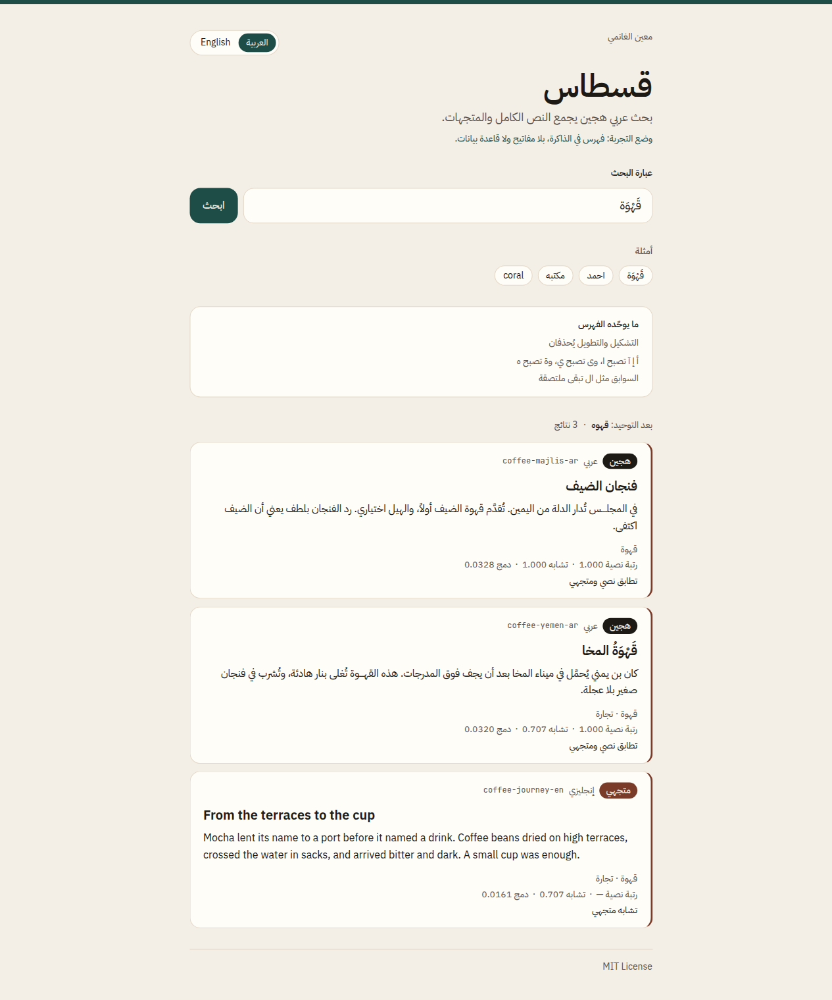

# Qistas

Arabic full-text and vector hybrid search, by Maeen Alganimi.

Arabic orthography hides matches a reader would treat as the same word. Qistas normalises the text, ranks it with Postgres full-text search, and fuses that rank with vector similarity.



## What it solves

A plain index misses everyday Arabic variants:

| Written | Folded | Why |
| --- | --- | --- |
| القَهْوَةُ | القهوه | tashkeel (diacritics) is deleted, and ة becomes ه |
| قهــــوة | قهوه | tatweel, used to justify a line, is deleted |
| أحمد، إسلام، آداب، ٱسم | احمد، اسلام، اداب، اسم | alef variants fold to ا |
| على | علي | alef maksura ى folds to ي |
| مكتبة | مكتبه | teh marbuta ة folds to ه |

Clitic prefixes stay attached. Under the `simple` text search config, `الكتاب` and `كتاب` are different tokens, so a query for one does not lexically find the other. The vector channel can still retrieve a document when the query and the document share a topic, including across Arabic and English.

## Architecture

```
query
  ├─ normalize_arabic → plainto_tsquery('simple') → GIN(tsvector) → rank
  └─ embed(query) → HNSW cosine distance → similarity
            └─ reciprocal rank fusion (k = 60) → results
```

The corpus lives in `documents`. A generated `search_vector` column stores `to_tsvector('simple', normalize_arabic(title || body))`, with a GIN index. Embeddings are `vector(32)` with an HNSW index (`vector_cosine_ops`). `hybrid_search(query, query_embedding, match_count)` takes the top lexical hits and the nearest vectors (cosine similarity at least 0.55), then fuses them:

```
score(document) = Σ 1 / (60 + rank)
```

A row is labelled `fulltext`, `vector`, or `hybrid` according to which lists it came from.

`simple` is deliberate. It is the config the in-memory ranker mirrors. You can switch the generated column to the `arabic` config if you want the built-in stemmer; that stemmer is not reproduced in the demo.

Demo embeddings are deterministic topic vectors, not a neural model. A small hand-written lexicon maps tokens such as `قهوة` and `coffee` onto the same topic, and each document carries topic labels. Replacing `embedQuery` and the `vector(32)` column is the path to a real embedding model. The SQL function does not care which model produced the vector.

## Run the demo

No API keys and no database:

```bash
npm install
npm run dev
```

Open [http://localhost:3000](http://localhost:3000). Try `قَهْوَة`, `احمد`, `مكتبه`, `كتاب`, and `coral`. The badge on each result says which channel matched.

`GET /api/search?q=قَهْوَة` returns the same JSON.

## Run against Supabase

1. Apply the SQL in order: `supabase/migrations/20261010170000_arabic_hybrid_search.sql`, then `supabase/migrations/20261010170100_seed_documents.sql`. The Supabase CLI (`supabase db push`) or the SQL editor both work. The second file is generated from `lib/documents.ts` with `npm run generate:seed`.
2. Copy `.env.example` to `.env.local` and set `SUPABASE_URL` and `SUPABASE_ANON_KEY`.
3. Restart `npm run dev`.

The page then calls `hybrid_search` with the same mock query embedding. Unset the variables to return to the demo.

## Tests

```bash
npm test
npm run lint
npm run typecheck
npm run build
```

Vitest covers normalisation, reciprocal rank fusion, and the demo ranker (diacritics, alef folding, teh marbuta, the definite article, and a cross-lingual vector hit). GitHub Actions runs lint, typecheck, test, and build.

## License

[MIT](LICENSE) © Maeen Alganimi
